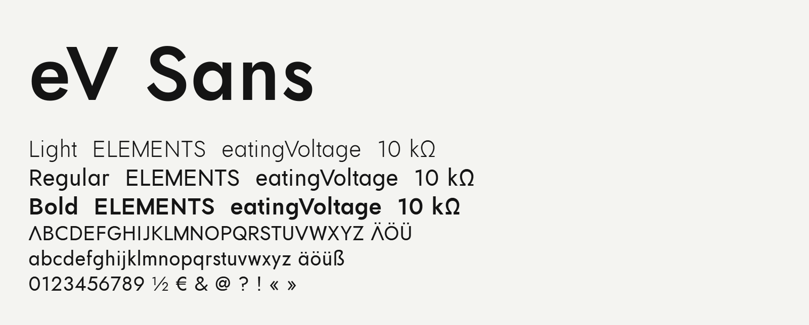

# eV Sans

eV Sans is the typeface of eatingVoltage: geometric, one stroke width throughout, and an A without a crossbar. It is
made from [Jost*](https://github.com/indestructible-type/Jost) by Owen Earl and is free to use under the SIL Open Font
License 1.1.



## Weights and files

| Weight | OTF | TTF | WOFF2 |
|---|---|---|---|
| Light 300 | `fonts/otf/eVSans-Light.otf` | `fonts/ttf/eVSans-Light.ttf` | `fonts/webfonts/eVSans-Light.woff2` |
| Regular 400 | `fonts/otf/eVSans-Regular.otf` | `fonts/ttf/eVSans-Regular.ttf` | `fonts/webfonts/eVSans-Regular.woff2` |
| Bold 700 | `fonts/otf/eVSans-Bold.otf` | `fonts/ttf/eVSans-Bold.ttf` | `fonts/webfonts/eVSans-Bold.woff2` |

Bold is drawn from Jost's 500 weight but marked 700, so it is the bold that apps and `font-weight: 700` pick. (1.001
had a Medium at 500 and a heavier Bold; 1.002 keeps the Medium's shapes as the Bold.)

Use the OTF files for design and typesetting tools, the TTF files for apps and Windows (they are autohinted for small
sizes on screen), and the WOFF2 files on websites:

```css
@font-face {
  font-family: "eV Sans";
  src: url("eVSans-Regular.woff2") format("woff2");
  font-weight: 400;
}
@font-face {
  font-family: "eV Sans";
  src: url("eVSans-Bold.woff2") format("woff2");
  font-weight: 700;
}
```

## Characters

Latin for the European languages, figures and fractions, punctuation, currency signs, and Δ Ω µ π for units. Ω and µ
are there under both of their code points (Ω U+03A9 and the Ohm sign U+2126; µ U+00B5 and U+03BC), so values like
10 kΩ and 4.7 µF come out the same however they were typed. The stylistic set `ss01` turns the single-storey a into
a two-storey one.

## Using it in your own project

The SIL Open Font License lets you use eV Sans for anything, commercial work included, embed it in documents and
apps, and bundle and redistribute it with your software. Keep `OFL.txt` with the font files, and don't sell the font
files on their own. If you change the font, your version stays under the OFL. Text you set in eV Sans, and anything
you make with it, carries no conditions at all.

## How it differs from Jost

eV Sans keeps Jost's skeleton and changes how it looks: the A without a crossbar, flat-cut points, an upright M, a
larger x-height, wider and narrower capitals, looser spacing, a single-storey a, a J on the baseline, shorter hooks on
g, j and J, a foot on the t, a straight y, one stroke width everywhere, square dots and a cap-height Ω.
[FONTLOG.txt](FONTLOG.txt) lists every change.

## License

Copyright 2020 The Jost Project Authors. Copyright 2026 eatingVoltage. Licensed under the SIL Open Font License,
Version 1.1: see [OFL.txt](OFL.txt), with a FAQ at https://openfontlicense.org.
